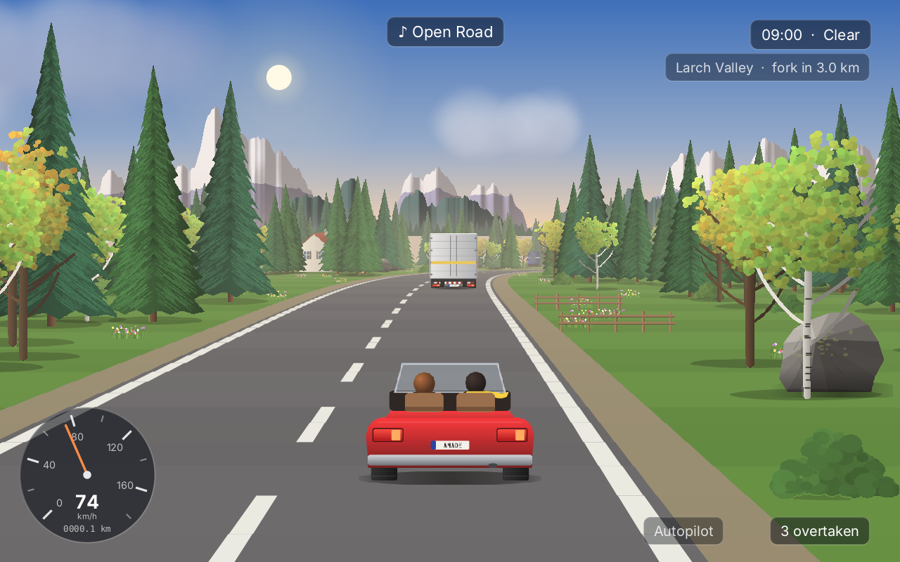

# amade-cruise-game

**amade-cruise-game** is the road game of the [amadeOS](https://github.com/amadeos-eu/amadeos) desktop: a relaxing drive through endless landscapes that are made as the road goes on, in the pseudo-3D of the old road games. Valleys, plains, the coast, a canyon with tunnels, a mountain pass, a neon city and two dream worlds follow each other; the sun goes down, it rains, fog comes up, and the traffic is there to be overtaken. A race mode sets the player against the computer or a second player at the same keyboard. Built on [amade-game-engine](https://github.com/amadeos-eu/amade-game-engine); runs on other operating systems as well.




## The journey

An endless journey with no goal and no clock: drive, look and overtake. The road leads from one region to the next: every four to six kilometres it forks, and the lane the car keeps to under the sign chooses which way. A small display under the clock names the region and the kilometres to the fork. In the canyon and on the pass the road runs through gorges, between rock with buttresses and niches, sometimes with the open land on one side.

- **Larch Valley**: larches, a river and the mountains beyond.
- **Amber Plains**: sunflowers, poplars, windmills and hay.
- **Azure Coast**: palms, lighthouses and the open sea.
- **Ember Canyon**: red rock, mesas and tunnels.
- **High Pass**: snow poles, chalets and cowbells.
- **Neon City**: lights that never sleep.
- **Lantern Fields** (a dream): giant mushrooms and floating lanterns.
- **Cloud Road** (a dream): a road above the clouds.

Each region sounds like itself (a river and birds, crickets in the grass, surf and gulls, wind in the rock, cowbells, the hum of the city, the chimes of a dream), and small life lives at the roadside: deer at the edge of the forest, cows and sheep with their bells, flocks of birds, a hawk, gulls, a train beside the road, boats on the sea, balloons, fireflies, and in the dreams paper lanterns and a whale swimming through the sky. The car sounds like its engine, the wind gets louder with the speed, and in the open roadster the birds are louder too.

The time of day runs on (an hour a minute) or stands still, and the weather changes or stays as chosen. The journal (**J**) keeps the regions found, the kilometres and the cars overtaken; **P** saves a photo in `~/Pictures/Cruise`.

## The race

Four routes (Coast Run, Canyon Sprint, Night Loop and Valley Tour) against five computer drivers that drive *Relaxed*, *Keen* or *Fierce*, or two players on one keyboard with the screen split in two. The traffic drives in the same direction.

## The cars

In the garage each player chooses a car and its colour:

- **Roadster**: open top, the wind, the birds and the sun.
- **Kestrel**: a sports coupé, quick, low and a little nervous.
- **Wanderer**: a camper van, slow and comfortable, with the best view.

On the road are trucks, buses, campers, tractors and the small cars *Tenda*, *Bubble* and *Rosso*.

## Playing

- **Up** is the gas, **down** the brake, **left** and **right** steer. The second player drives with **W**, **A**, **S** and **D**.
- **Space** (the second player **E**) is the horn, **C** lets the car drive itself, **Esc** pauses.
- **Ctrl+R** switches the music off and on, **R** changes the station (the game's own tunes or the playlist), **N** plays the next track.
- **F11** switches to full screen and back. *Game → Graphics* chooses how the picture reaches the screen: **Automatic** (as sharp as the screen while the computer keeps up, at half or a third of the sharpness when it does not; the game measures its frames and chooses), **Direct** (always as sharp as the screen) or **Pixels** (640 × 400, enlarged by whole factors). **F12** shows how long each frame takes, and in *Automatic* the step the game has chosen.
- Gamepads: the stick steers, **A** or **RB** is the gas, **B**, **X** or **LB** the brake, **Y** takes a photo, **Back** plays the next track, **Start** pauses. In the race, the first pad drives for the first player and the second for the second.

*Game → Settings* has the music and its loudness, the loudness of the car and of the landscape, the playlist, the time of day, the weather and how busy the roads are.

### The playlist

The playlist takes files and folders; a folder plays everything in it that the game can read. The game needs no music player of the system: it plays MP3, Ogg Vorbis, FLAC, WAV and AIFF with Java decoders it brings along. Modules (MOD, XM, S3M, IT and more) play through `libopenmpt` when it is installed (`libopenmpt0` on Debian). The playlist plays in order or shuffled.

The keys can be changed in `~/.config/amadeos/cruise/cruise.properties`, with the names Java gives them, several separated by spaces:

```properties
keys.gas=UP
keys.brake=DOWN
keys.left=LEFT
keys.right=RIGHT
keys.horn=SPACE
keys.autopilot=C
keys.photo=P
keys.journal=J
keys.next-track=N
```

Texts in English, Deutsch, Français, Español and Italiano.

## Gamepads

Plugged in before or while the game runs. *Help → About* shows how many are connected.

- **Linux**: the game reads `/dev/input/js0` to `js3`, which needs read access to them (on most desktops the user at the screen has it). The buttons follow the Xbox layout of the `xpad` driver.
- **Windows**: XInput, so Xbox and compatible controllers.
- Elsewhere the game runs without gamepads.

## Files

| What | Where |
|---|---|
| Settings (music, loudness, playlist, time, weather, traffic, graphics, keys, cars) | `~/.config/amadeos/cruise/cruise.properties` |
| The journal | `~/.local/share/amadeos/games/cruise/journal.properties` |
| Photos | `~/Pictures/Cruise/` |

## Building

```bash
./gradlew test          # the window tests need a display (xvfb-run on servers)
./gradlew run
./gradlew deb           # build/distributions/amade-cruise-game_<version>_all.deb
./gradlew installToAmadeOs   # copies the package to ../amadeos/config/packages.chroot/
./gradlew benchmark     # how long a frame of each region takes; -Pscale=3 for a full screen of 1920 x 1200
```

Gamepads on Windows go through Java's foreign function interface (the modules through JNA), so the game starts with `--enable-native-access=ALL-UNNAMED` (set in `build.gradle` for `run`, the tests and the packages).

All pictures are drawn with Java2D at run time and all sounds and tunes are made by the game itself; the icon is drawn by `tools/MakeIcon.java`. `./gradlew screenshots -Pshots=<folder>` draws the handbook's screenshots.

With `../amade-game-engine` (and `../amade-commons`) checked out next to this repository, Gradle builds those checkouts instead of the published versions.

## Structure

- `domain`: the world and its rules, without user interface or time of their own. `World` (lays the road region by region, with curves, hills, tunnels, forks and the things beside it), `Region`, `Looks`, `PropKind`, `Trip` (a journey or a race: the drivers, traffic, wildlife, clock and weather in one step), `Driver`, `Autopilot`, `TrafficPlan` and `Vehicle`, `Wildlife` and `LifeKind`, `Ambience`, `DayClock`, `Weather`, `Race`, `Journal`, `CarModel`, `Seeds`, `Input`.
- `repository`: `CruiseSettings` and `JournalStore`.
- `ui.game`: the running game on the loop thread. `CruiseGame` (loop, controls, scenes: title, journey, pause, garage, journal, race setup, race, results), `View` (camera and road), `Sky` (sky, sun, clouds and the backdrops of each region), `Art`, `CarArt` and `Paint` (the drawings), `Hud`, `SoundBank` and `Synth` (the sounds), `Music` (the tunes, in MML), `CarAudio` (engine, wind, ambience and radio), `Playlist` and `Modules` (the player's own music), `Arena` (what the presenter may ask of the game).
- `ui.main`: Model-View-Presenter for everything around the road: `CruisePresenter`, `CruiseView`, `CruiseWindow`, `SettingsDialog`.

From the engine's `drive` package: `Road`, `Segment`, `RoadCamera`, `RoadRenderer`, `RoadSprite`, `RoadLook`, `Car`, `Traffic`, `Panorama`. Also `Gamepads`, `GameLoop`, `GameCanvas`, `Sound`, `Tune`, `Mixer` with its beds, `Keyboard` and `Controls`, `SceneStack`, `FullScreen`.

Comments of the form `// --8<-- [start:name]` mark the excerpts the [Game Developer's Handbook](https://docs.amadeos.eu/amade-game-engine/) quotes; chapter 61 is about this game.

## Licence

[EUPL-1.2](LICENSE)
